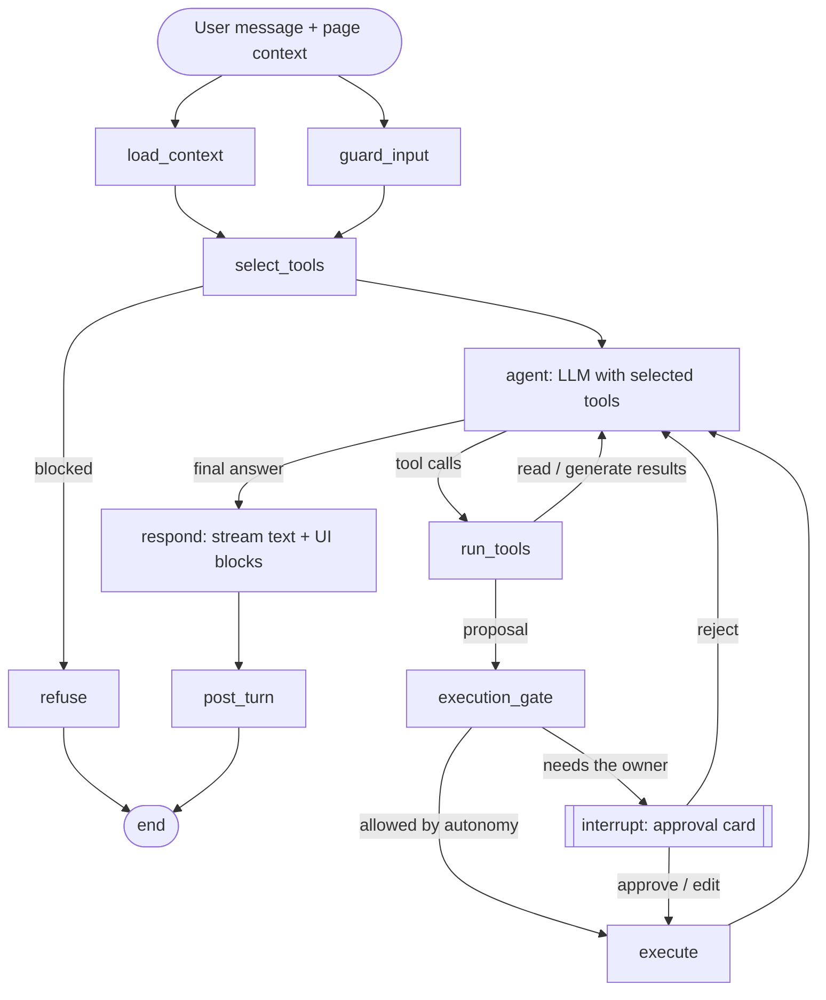

# Copilot Agent Design

Status: step 1 built, 2026-11-17 (proposed 2026-11-16). Companion to `ARCHITECTURE.md` sections 5 and 6 and `docs/BUSINESS_BRAIN.md`. Runtime choice in ADR 0005.

The copilot is one chat surface from which an owner can do anything the product can do: ask about the business, fill or edit the profile, get ideas, create captions, images and reels, schedule and publish, and ask about results ("how did my last post do?"). It answers from the Business Brain and acts through the same services the UI uses.

## 1. Principles

1. **The model chooses; code decides.** The LLM picks tools and arguments. Deterministic code checks role, autonomy, guardrails and credits, then executes (CLAUDE.md rule 3).
2. **Tools wrap services, never tables.** Every tool calls a module's public API (`index.ts`), so RLS, validation, idempotency and audit apply exactly as they do for the UI. **No text-to-SQL.** The model never writes a query.
3. **Every UI action is a tool.** When a module ships a feature, it ships the tools for it. The copilot's reach grows with the product and is never a parallel implementation.
4. **Few tools per turn.** The catalogue grows to 100+ tools. Only the 8-15 relevant ones are sent each turn (section 4).
5. **Answers render as UI, not walls of text.** The agent returns typed blocks (metric cards, charts, post previews, profile diffs, approval cards) that the web app renders with `packages/ui`.
6. **Tenant and user come from the session, never from the model.** No tool takes a `workspaceId`, `brandId` or `userId` argument.

## 2. Where it lives

```
apps/api/src/modules/
  agents/
    copilot/            graph, nodes, prompts, SSE controller
    runtime/            tool registry, tool selector, execution gate, checkpointer, limits
    strategist/         subgraph (30-day plan), exposed to copilot as a tool
    creative/           subgraph (multi-asset creation), exposed to copilot as a tool
    conversations/      conversation and message repositories, summariser
  <every other module>/
    agent-tools.ts      the tools this module contributes, exported from index.ts
  ai/                   new capability: AiService.converse() with tool calling
```

- `modules/ai` gains one capability: `converse({ task, messages, tools, stream })`. It routes by task tier (ADR 0004 model config) and returns tool calls or text. It is the only code that touches `LlmPort`. LangGraph never sees a provider SDK or a LangChain chat model.
- Each module contributes tools by exporting a provider. The agents module collects them at boot. Agents import only module `index.ts` files (rule 4).

## 3. The graph



| Node | Does | Model |
|---|---|---|
| `load_context` | Auth context, current page and selection, conversation summary plus last N messages, L1 core from `MemoryService.buildContext('copilot.turn')`, autonomy settings, credit balance | none |
| `guard_input` | Prompt-injection and policy screen on user text, plus domain tags for routing. Runs beside `load_context`. Fails open (tools are already bound by role and tenant). Retrieved content is always wrapped as data, never as instructions | classification tier |
| `select_tools` | Picks the tool set (section 4) from the domain tags of `guard_input`. A turn that L1 already answers simply makes no tool calls | none |
| `agent` | Tool-calling loop: reasons, calls tools (in parallel when independent), reads results, decides the next step | reasoning tier |
| `run_tools` | Validates arguments with the tool's Zod schema, checks RBAC, runs read and generate tools, and turns `propose_*` results into proposals | none |
| `execution_gate` | `ExecutionService.evaluate(proposal)`: role, autonomy level per workspace and channel, guardrails, credits. Returns `auto`, `ask` or `deny` | none |
| interrupt | Pauses the run (state checkpointed), streams an approval card, resumes when the owner answers, even hours later | none |
| `respond` | Streams the final text and typed UI blocks, plus 2-3 suggested follow-ups | reasoning tier (same call) |
| `post_turn` | Runs in `RunDriver` after the stream ends, from exactly what the owner was shown: persists the reply, sets run status, refreshes the rolling summary when the thread is long. Later: settles credits, writes the episode, memory write evaluation | writing tier, async |

**Hard limits per run:** 8 agent steps, a token ceiling, a credit ceiling (reserved up front) and a wall-clock timeout. Hitting a limit ends with a clear message, never a silent stop.

**Subagents as tools.** Strategist and Creative are LangGraph subgraphs that the copilot calls like any tool (`plan.create_month`, `creative.make_campaign_assets`). This is simpler to reason about than free handoffs between agents, and each subgraph keeps its own prompts, limits and evals.

## 4. Dynamic tool selection

Sending every tool every turn costs tokens and lowers selection accuracy. Selection runs in two stages, plus an escape hatch:

1. **Route.** The router tags the message with domains. The tool registry returns that domain's tools.
2. **Rank.** Tool descriptions are embedded once at boot. The message is matched against them and the top results are merged with step 1, then capped at about 15 tools.
3. **Always on:** `tools.search(query)`, a meta tool the agent calls when it needs a capability it was not given. The next step binds the found tools. This is what makes the tool set dynamic mid-run.
4. Always on: `brain.search` (Business Brain retrieval) and `ui.ask_user` (ask a clarifying question with options).

Tools also carry `pages` hints: on the Brand profile page, profile tools rank first.

## 5. Tool contract

```ts
// apps/api/src/common/agent-tools/tool-definition.ts (server only: tools hold run functions)
type ToolKind = 'read' | 'generate' | 'propose';

interface ToolDefinition<TArgs, TResult> {
  name: string;                    // 'analytics.post_metrics'
  domain: ToolDomain;              // 'analytics'
  kind: ToolKind;
  description: string;             // written for the model: when to use it, when not to
  args: ZodType<TArgs>;            // converted to JSON Schema for the model
  result: ZodType<TResult>;
  permission: Permission;          // RBAC check before run
  credits?: (args: TArgs) => number;
  render?: UiBlockType;            // how the web app shows the result
  run(ctx: ToolContext, args: TArgs): Promise<TResult>;
}

interface ToolContext {            // built from the session, never from the model
  workspaceId: string; brandId: string; userId: string; role: Role;
  runId: string; idempotencyKey: string; // hash(runId, step, name, args)
  signal: AbortSignal;
}
```

| Kind | Examples | Execution |
|---|---|---|
| `read` | `profile.get`, `brain.search`, `posts.list`, `analytics.post_metrics`, `analytics.query`, `calendar.list`, `credits.balance` | Immediate. Results are trimmed to a summary before going back to the model |
| `generate` | `ideas.generate`, `caption.generate`, `image.generate`, `reel.render_template` | Creates drafts only. Shows a credit chip; above the per-turn threshold it asks first. Long jobs go to BullMQ and stream progress |
| `propose` | `profile.propose_update`, `product.propose_change`, `calendar.propose_schedule`, `publish.propose_now`, `post.propose_delete` | Returns a proposal object. Only `ExecutionService` executes it |

**Answering "anything about my activity"** without text-to-SQL: `analytics.query` takes a small structured spec (`metric`, `dimensions`, `filters`, `range`, `sort`, `limit`) validated by Zod and compiled to SQL by the analytics module over its own views. Common questions get named tools (`analytics.post_metrics({ which: 'latest' })`) because they are cheaper and more reliable.

## 6. Propose, approve, execute

```
agent calls profile.propose_update({ field: 'tagline', value: '...' })
  -> run_tools stores a pending_action (diff, reason, cost, undo plan)
  -> execution_gate: Level 0-1 for this action -> ask
  -> interrupt: web renders ProfileDiffCard [Approve] [Edit] [Reject]
  -> owner approves -> resume(runId, decision)
  -> ExecutionService.execute(pending_action, idempotencyKey)
  -> audit_event + memory_event (user_stated, trust 3)
  -> agent continues: "Done. Your tagline is updated. Undo?"
```

- **Every write asks (owner decision, 2026-11-17).** In Phase 1 the gate returns `ask` for every `propose_*` tool, whatever the autonomy level: profile, catalogue, calendar, publishing and deletes alike. `auto` stays in the gate's contract so autonomy levels can relax this later without changing tools.
- Every executed action records an inverse where one exists, so the chat can offer **Undo**.
- A preference stated in chat ("never use emojis") becomes a proposed brand rule with a "Save as rule?" card, not a silent memory write.

## 7. Interactivity

- **Transport:** SSE on `POST /v1/copilot/conversations/:id/messages` (the existing job-events convention). Event types are Zod-typed in `packages/contracts`: `text.delta`, `tool.started`, `tool.finished`, `ui.block`, `approval.required`, `job.progress`, `suggestions`, `error`, `done`.
- **Generative UI:** the agent emits blocks (`metric_card`, `chart`, `post_preview`, `idea_list`, `profile_diff`, `approval`, `asset_grid`, `choice`) that are validated server side and rendered by components in `packages/ui`. The model never emits HTML.
- **Visible work:** each tool call shows as a compact step ("Checking your last 5 posts...") that can be expanded.
- **Context aware:** each message carries the current route and selection, so "make this shorter" on a draft knows what "this" is.
- **Shell:** right panel on desktop, bottom sheet on mobile (DESIGN.md section 5). Opened from every screen with a keyboard shortcut. Stop button cancels the run (AbortSignal through tools and jobs).
- **Clarify, do not guess:** `ui.ask_user` with tappable options when a request is ambiguous ("Which product?").

## 8. Memory and conversation

| Concern | Approach |
|---|---|
| Short-term | Last N messages plus a rolling summary per conversation, refreshed in `post_turn` |
| Business facts | `MemoryService.buildContext` for L1 every turn; L2, L3 and L4 only through `brain.search` and task tools |
| Freshness | Metrics, credits and schedule always come from tools, never from memory or cache (BUSINESS_BRAIN section 8) |
| Learning | `post_turn` memory write evaluation: approved outputs become L3 episodes; corrections become proposals |
| Prompt caching | Stable prefix order: system prompt, tool schemas, L1 core, summary, then the new turn |

## 9. Data model (new tables, all tenant-scoped with RLS)

| Table | Holds |
|---|---|
| `conversation` | Title, user, brand, rolling summary, last activity |
| `message` | Role, content, UI blocks, token counts. Append-only |
| `agent_run` | One per user turn: status, limits, cost, model ids, Langfuse trace id |
| `agent_checkpoint` | LangGraph state per step (our Prisma checkpointer) for resume and replay |
| `agent_checkpoint_write` | Writes made between two checkpoints (required by the saver contract) |
| `tool_call` | Name, arguments, result summary, duration, idempotency key, error |
| `pending_action` | Proposal, diff, cost, decision, decided by and when, execution result, undo plan |

These are additions to `modules/agents`, not changes to memory or credit tables.

## 10. Safety

- Tenant scope is bound in `ToolContext` from the auth session, and RLS enforces it again.
- RBAC is checked per tool before it runs. An Analyst's copilot simply has no propose tools.
- Tool arguments and results are Zod-validated. Invalid arguments go back to the model as a typed error, at most twice.
- Crawled pages, comments and DMs are fenced as untrusted data. A tool result can never grant new tools or permissions.
- Every side effect is idempotent by key, so a retried step cannot double-publish or double-charge.
- PII is redacted from traces. Tokens and secrets never enter model context.

## 11. Quality

- **Evals in CI** on any prompt, tool description or model change: about 200 labelled requests in English, Hindi and Hinglish. Each checks tool selection, argument correctness, the final state after execution, and that nothing executed without approval when it should have asked.
- **Online:** task success, approval rate, undo rate, turns per task, cost per run, p95 time to first token (target under 1.5 s).
- **Replay:** any run can be replayed from `agent_checkpoint` with recorded model outputs to debug.

## 12. Build order

Each step is usable on its own and follows the modules as they ship.

| Step | Delivers | Depends on |
|---|---|---|
| 1 | Runtime: graph, registry, selector, checkpointer, SSE, chat panel, `brain.search`, `profile.get`, `tools.search`. **Built 2026-11-17** | ADR 0005 accepted |
| 2 | Profile and catalogue edits through proposals and approval cards, with undo | `ExecutionService` |
| 3 | Ideas and captions as drafts with credit chips | M3, M13 ledger |
| 4 | Images and template reels as background jobs with progress | M3 studio jobs |
| 5 | Calendar and publishing proposals | M5, M6 |
| 6 | Analytics Q&A: named tools, then `analytics.query` | M9 |
| 7 | Strategist and Creative subgraphs | Steps 3-5 |

## 13. Owner decisions (2026-11-17)

1. **Writes:** every copilot write asks for approval first (section 6).
2. **Per-turn credit ceiling:** to be set once generation and billing exist. Until then the limit is a config value, and every credit-spending tool asks.
3. **Chat history:** every conversation and message is stored in our database. A retention job that deletes history after a set period (around one month) comes later. Until then nothing expires. The schema keeps `last_activity_at` on `conversation` so the job can be added without a migration of existing rows.
